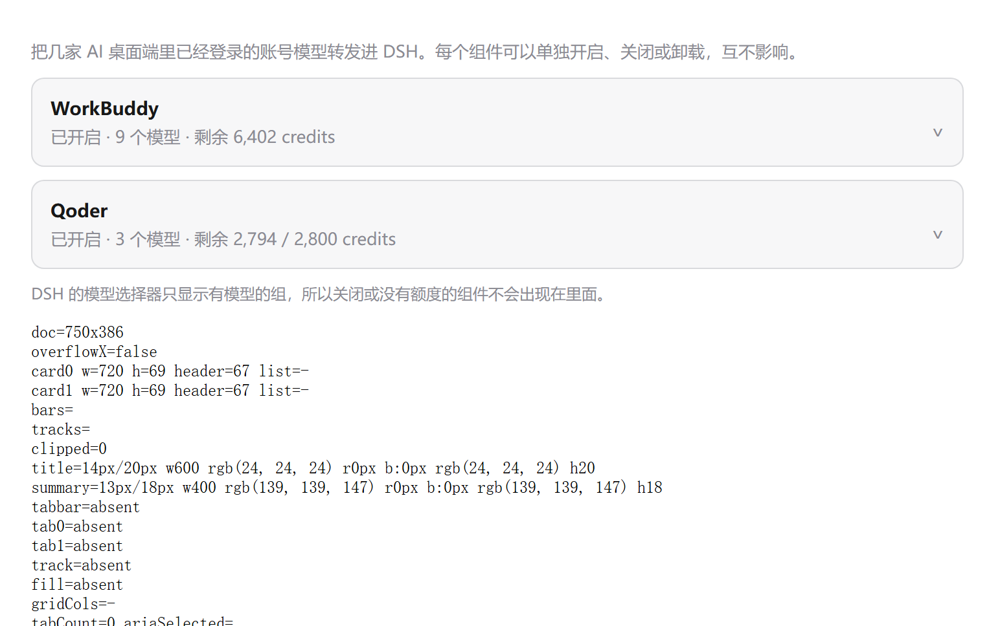
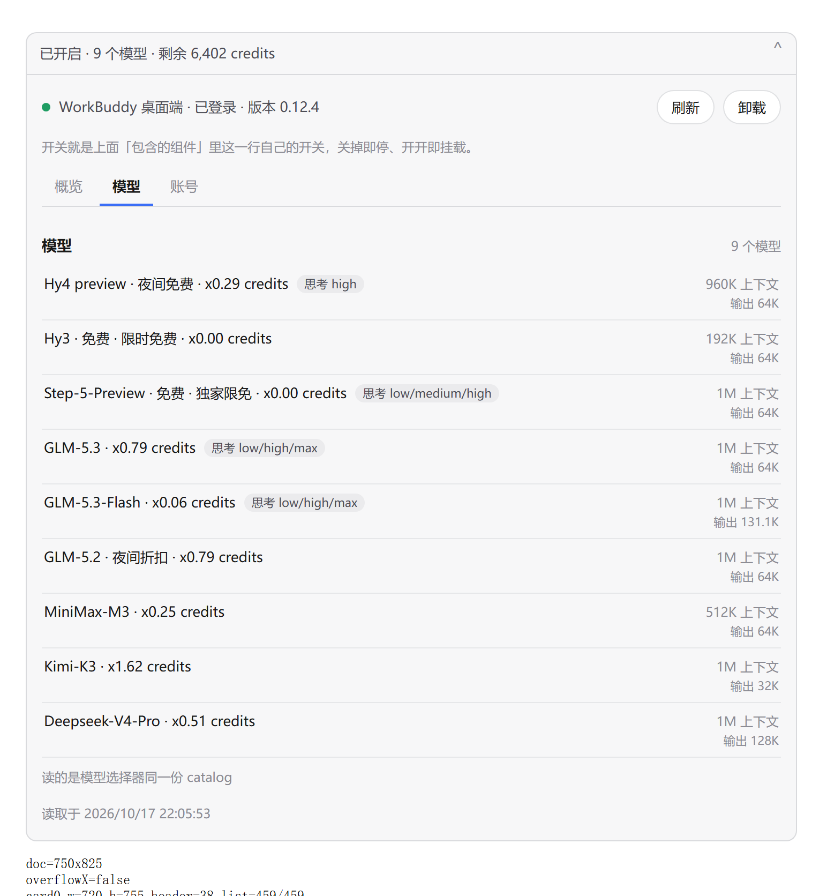
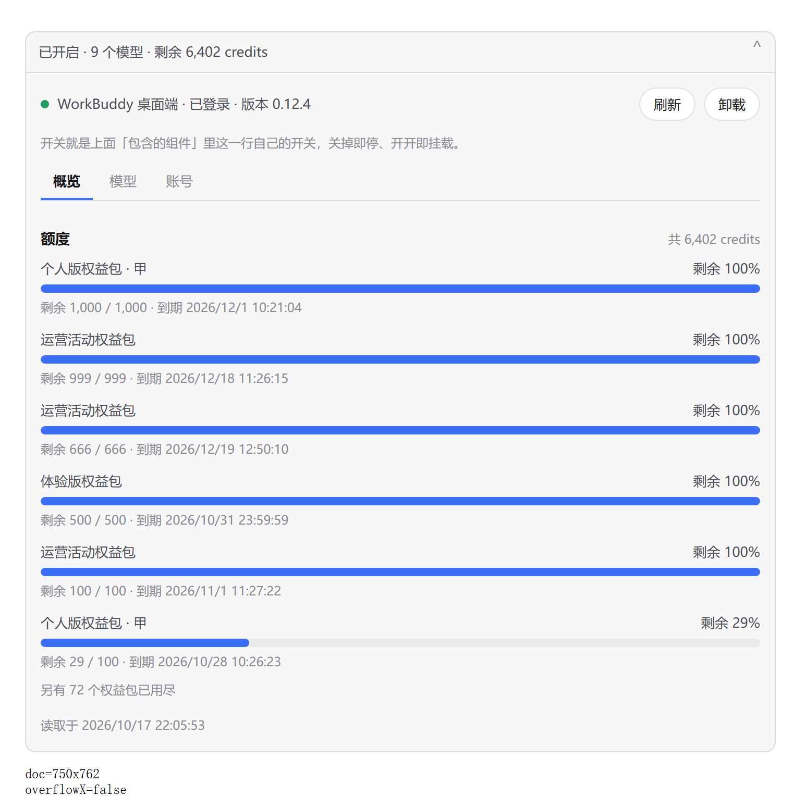

# DSH Agent Bridge

[English](./README.en.md) | 中文

把本机 AI 桌面客户端里已登录的模型，反向代理进 [DeepSeek Harness](https://github.com/deepseek-ai)（DSH）。

不新建 API Key，也不重走 OAuth：插件复用客户端的安装位置和登录态，客户端里能用的模型，DSH 里就能用。
| 厂商 | 模型 | 额度 | 思考强度 | 通道 |
| --- | --- | --- | --- | --- |
| Qoder | 14 | 剩余积分 | 按模型给档位或开/关 | 子进程 + 控制帧 |
| WorkBuddy（含国际版 WorkBuddy AI） | 19 | 剩余积分 / 权益包 | 部分模型有档位 | HTTP + SSE |

模型数是一次实测的快照，会随账号状态和上游调整浮动。


## 兼容的 DSH 版本

| | 版本 |
| --- | --- |
| DSH 桌面端（实测） | **0.2.0-rc.2** |
| 声明的运行时范围 | **`^0.2.0-rc.2`**（放行 0.2 整条线，拒绝 0.3） |
| `@deepseek-ai/dsh-llm` | 0.2.0-rc.2（peer `^0.2.0-rc.2`） |
| `@deepseek-ai/dsh-client-ui-plugin-manager` | 0.2.0-rc.2 |
| `@deepseek-ai/cordis` | 4.0.4（peer `^4.0.2`） |
| Node | 24.21.0（要求 `^22.19.0` 或 `>=24`） |

DSH 加载插件前，会把 `peerDependencies` 里的 `@deepseek-ai/dsh*` 与正在运行的版本比对，对不上就跳过整个 bundle：

```
dsh: skipping profile bundle "dsh-agent-bridge": Plugin dsh-agent-bridge@1.0.0 is
incompatible with dsh 0.2.1: peerDependencies {"@deepseek-ai/dsh-llm":"0.2.0-rc.2"}.
```

所以这里写范围而不是精确版本：精确锁会让 DSH 的每个补丁版都把插件静默跳过。被拒载时可以按「插件版本 × DSH 版本」单独放行：

```jsonc
// %USERPROFILE%\.dsh\profiles\desktop\compatibility.json
{ "dsh-agent-bridge@1.0.0": ["0.3.0"] }
```

依赖的 DSH 接口清单、升级后的自检步骤见 [docs/compatibility.md](docs/compatibility.md)。`npm test` 里的 `test/compat.mjs` 会检查这份声明有没有被改坏。


## 功能

- **零配置**：装好即用，不填 key、不二次登录。账号在客户端里切换，插件跟随。



- **一个包，两个组件**：`cordis.patch.yml` 插两行 Loader，同一个模块、两个 `config.component`。插件页显示一张包卡加两行组件，每行有自己的开关和详情页；关掉一家，另一家的路由、定时器、子进程不受影响。

- **流式对话，含思考过程**：上游给 `reasoning-delta` 就转发成 DSH 的折叠思考块。

- **思考强度**：只显示上游声明的档位（`low / medium / high / xhigh / max`，可关思考的模型多一个 `Off`）。没声明就不显示，不猜也不探测。



- **额度在分组标题上**：`Qoder · 2,427 credits left`、`WorkBuddy · 6,549 积分`。

- **设置卡片**：每行展开是「概览 / 模型 / 账号」三页签。额度按权益包给条，用尽的收成一行计数；模型列表与选择器同源；账号栏是驱动 `locate()` 的原始结果。



- **卸载可恢复**：卸载把该家的驱动目录移到 `$DSH_HOME/agent-bridge-removed/<id>/`，重装不会顺带装回来，点「恢复」可以还原。

- **故障隔离**：驱动加载失败、缺客户端、注册冲突，都只让这一家显示「不提供」，另一家照常工作。


## 安装

需要 Windows，已安装并登录至少一个受支持的客户端，DSH 桌面端在运行。两个驱动依赖 Windows 的安装路径与凭据文件，暂不支持 macOS / Linux。

1. 取源码：

```powershell
git clone https://github.com/AbyssWhalen/dsh-agent-bridge.git
cd dsh-agent-bridge
```

2. 把 bundle 登记进 profile（DSH 不会自动发现未登记的插件）：

```jsonc
// %USERPROFILE%\.dsh\profiles\desktop\package.json
{
  "dependencies": {
    "dsh-agent-bridge": "file:./plugins/dsh-agent-bridge"
  },
  "dsh": {
    "profile": {
      "bundles": [/* …原有项… */, "dsh-agent-bridge"]
    }
  }
}
```

3. 同步并安装：

```powershell
.\tools\sync.ps1                 # desktop profile
.\tools\sync.ps1 -Profile xxx    # 其它 profile
```

脚本会先确认 profile 清单里确实列了本插件，再复制源码、装依赖，最后逐文件比对源码与 `node_modules` 的哈希。改过源码要重跑一次并重启 DSH：pnpm 对 `file:` 依赖用硬链接，复制之后的改动不会自动同步。

如果 profile 里已有别的插件接管同一家厂商（例如 `dsh-workbuddy-connect` 与本插件的 WorkBuddy 驱动），只留一个：从 `dsh.profile.bundles` 去掉它，同时删掉 `dependencies` 里那条依赖，否则它还会留在磁盘上（虽然不加载）。DSH 对同一个 provider id 只接受一个 adapter，本插件遇到冲突只跳过冲突的那一家并记一条日志。


## 各家依赖

**Qoder**

- 需要 Qoder 桌面端已安装并登录，凭据在安装目录的 `auth.v1.dat`，只读取、不外发。
- 模型列表和额度走 Qoder 自己的接口；对话走它自带的 worker runtime，因为公开 HTTP 端点对第三方请求返回 503。
- 思考强度按 `thinking_config` 给：有 `enabled.efforts` 的给档位，只有 `disabled`/`enabled` 的给开/关，两者都没有的不给控件。

**WorkBuddy**

- 国内版显示为「WorkBuddy」，国际版显示为「WorkBuddy AI」，装哪个出现哪个，两个都装就两组并存，各自用自己的账号和积分。
- 凭据文件加密，按 `dsh-workbuddy-connect` 已公开的流程在本地解开，只用于本机请求。
- `Off` 的语义是不发这个字段，上游把缺省当作默认；两区端点都拒绝字面量 `off`。
- 模型名后的倍率和促销徽章（`GLM-5.3 · x0.79 credits`、`Hy3 · 免费`）来自服务端字段，不是插件算的。


## 环境变量

都是可选的，用于排查问题。

| 变量 | 作用 |
| --- | --- |
| `DSH_BRIDGE_POLL_MS` | 模型/额度刷新间隔，默认 5 分钟，范围 5 秒 ~ 24 小时 |
| `QODER_INSTALL_DIR` | 覆盖 Qoder 安装目录 |
| `WORKBUDDY_ELECTRON_BIN` | 覆盖 WorkBuddy 可执行文件 |
| `WORKBUDDY_AUTH_FILE` | 覆盖 WorkBuddy 凭据文件 |


## 开发与验证

```powershell
npm install
npm test                # 离线：契约与状态机，不需要客户端，不发网络请求
npm run test:host       # 替身 ctx 跑真 apply()：注册、分组标题、开关隔离、路由权限
npm run test:soak       # 反复开关 + 定时刷新，查适配器/路由泄漏（-Rounds=N 改轮数）
npm run test:collision  # 另一个插件占着同一 provider id 时的降级与恢复
npm run test:live       # 实机：两家各跑模型数 / 额度 / 两轮真对话
npm run test:counterfactual  # 反向验证：把历史截断放回去，看 replay-shape 是否变红
```

- `npm test` 与 CI 是同一组；`test:host`、`test:soak`、`test:collision`、`test:live` 需要本机装着对应客户端，一个都没有时 `test:host` 打印 `SKIPPED`。
- 逐驱动探针：`node test/integration/leak.mjs qoder`、`node test/integration/turn-teardown.mjs qoder`、`node test/integration/drain.mjs workbuddy 20`，分别查列模型后的子进程残留、一轮对话后的残留、收尾后事件循环是否干净。

实测记录见 [docs/verification.md](docs/verification.md)。

### 在真 DSH agent 循环里验

上面所有测试都是驱动直连。**工具在真循环里能不能用，只有真循环能证明**——只有那里，DSH 的系统提示才会推着模型去发起工具调用。搭法（隔离 `DSH_HOME` + headless profile）、判据（工具真执行 **且** 无标记泄漏，两条缺一不可）、排查表见 [docs/real-loop.md](docs/real-loop.md)：

```powershell
pwsh -File tools/real-loop-check.ps1 -Profile e2e -Runs 5 -Provider qoder
```


## 目录

```
lib/
  index.js      宿主：按组件挂载/卸载、注册 provider、刷新循环、日志
  state.js      组件开关持久化、卸载/恢复
  routes.js     /plugins/dsh-agent-bridge/<id>/{status,action}
  client.js     浏览器半身：包页 + 每行详情页
  adapter.js    唯一的 LlmAdapter
  catalog.js    模型与额度的本地快照
  pool.js       会话池
  messages.js   DSH 消息 → 厂商中立消息
  effort.js     思考强度归一化
  quota.js      额度文本
  driver.js     驱动契约校验
drivers/
  qoder/        session.js 子进程通道 · upstream.js HTTP · conversation.js · models.js · locate.js
  workbuddy/    seal.js 解密 · upstream.js · conversation.js · models.js · auth.js · locate.js
tools/
  sync.ps1      同步源码到 profile 并安装
test/           离线测试 · integration/ 宿主集成 · *-live.mjs 实盘
```

设计取舍见 [docs/design.md](docs/design.md)。


## 与 dsh-workbuddy-connect 的关系

宿主层形状沿用 `dsh-workbuddy-connect`，能对上的地方不另发明一套。

| | dsh-workbuddy-connect | 本插件 |
| --- | --- | --- |
| 范围 | WorkBuddy（国内 + 国际两分组） | Qoder / WorkBuddy，一个包 |
| 组件化 | 一个 Loader 行 | 两个 Loader 行，各带开关与详情页 |
| 设置页 | 一张卡、三页签 | 包卡 + 每行一张卡、三页签 |
| 额度 | 输入框旁 + 卡片 | 分组标题 + 卡片 |
| 思考强度 | 声明优先，未声明的主动探测（消耗积分） | 只按声明，不探测 |
| 上下文窗口 | 国际版可切「用上游最大窗口」 | 只上报静态窗口 |
| 卸载 | — | 驱动移出包、可恢复 |
| 许可 | MIT（Corrine Hu） | MIT，保留其声明 |

两处不同是有意的：

- **不探测思考强度。** 两家上游都把档位写在模型元数据里（Qoder 的 `thinking_config`、WorkBuddy 的 `supportedEfforts`），没有需要试探才知道的模型，也就不发会扣额度的探测请求。
- **上下文窗口不是开关。** DSH 的请求契约里没有「这次请求换窗口」的字段，窗口是模型元数据，驱动压缩与计量。做成开关只能在上报时二选一，而两个数字都只对部分模型成立。


## 工具调用

DSH 是编码代理，模型必须能调用工具才算真的能用。插件把 harness 的工具声明原样转给上游（WorkBuddy 是 OpenAI 的 `tools` 信封），并把上游流式返回的 `tool_calls` 片段重组成 harness 的分块序列（`block-start` → `tool-call-delta` → `block-end`，`finish` 报 `tool-calls`）。

历史里的工具调用也按原生结构重放：助手消息带 `tool_calls`，结果按 `tool_call_id` 对应。**不要**把它压成 `[tool call: …]` 文本——上游会拒绝一条没有对应调用的 `tool` 消息，而模型也分不清两次调用。

有工具时不再注入「你没有工具」的前导语：那和真实工具列表直接矛盾，模型会退回去用 `<tool_call>` 文本代替真正的调用，表现就是**每轮都是空回复**。

### 模型把调用写成文本时的恢复

上游模型的调用通道偶尔不生效，它们会把调用**当正文写出来**。插件拦截并还原成真调用，而不是把标记流到屏幕上。截下来的一共四类：

```
<｜｜DSML｜｜invoke name="pwsh">     ← 原生 DSML，竖线数量与 `DSML` 有无都会漂移
<｜tool_name>pwsh</｜tool_name>      ← 模型自创的语法，后跟 <command>…</command>
<｜tool_call><name>…</name><arguments>{…}</arguments></tool_call>
<｜｜｜▁begin｜>function<｜tool▁sep｜>pwsh  ```json {…} ```  ← 分词器自己的控制 token
```

第四类不是模型自创的方言，是它**自己的函数调用 token** 漏进了正文通道（`▁` 是 U+2581，分词器代替空格的符号）。它的参数是围栏里的 JSON 对象，所以最好恢复。

判定规则刻意宽松、删除规则刻意严格：

- 竖线上限 32 根、`DSML` 可省、开标签的 `parameter` 一词可省、`_` 与 U+2581 互换——这些都在真机上出现过；
- **裸竖线**只在后面跟已知标签名时才算调用，所以 `a || b`、markdown 表格、`<b>bold</b>` 原样通过；
- 恢复不出参数就**不执行**。宁可显示原始块让用户看见发生了什么，也不能拿 `{}` 去调工具——真机上这个错误让模型试了六次并最终判定「harness 坏了」；围栏里 JSON 截断时同理。

模型重复 `｜` 到预算耗尽（抓到过 500 根）算退化轮，按失败结束并说明原因，不当作回答渲染。

## 已知限制

- 只支持 Windows。
- 只反代官方套餐通道，客户端里自己贴 Key 加的 provider 不会被接管。
- 额度是余额还是已用取决于厂商怎么报，插件照实显示，不换算。
- 能用哪些模型取决于客户端里的账号状态，插件不登录、不充值、不绕过限制。
- 改过源码要重跑 `tools\sync.ps1` 再重启 DSH。


## 许可

MIT，见 [LICENSE](LICENSE)。

宿主层设计（组件化 Loader 行、两条设置路由、能力探测边界）与 WorkBuddy 驱动的凭据解密流程派生自 [`dsh-workbuddy-connect`](https://github.com/corrinehu/dsh-workbuddy-connect)（MIT, Copyright (c) 2026 Corrine Hu），许可声明已保留。
